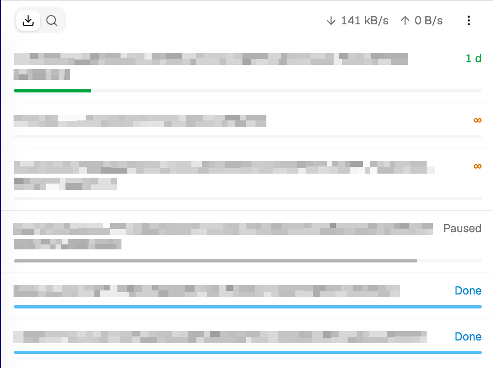
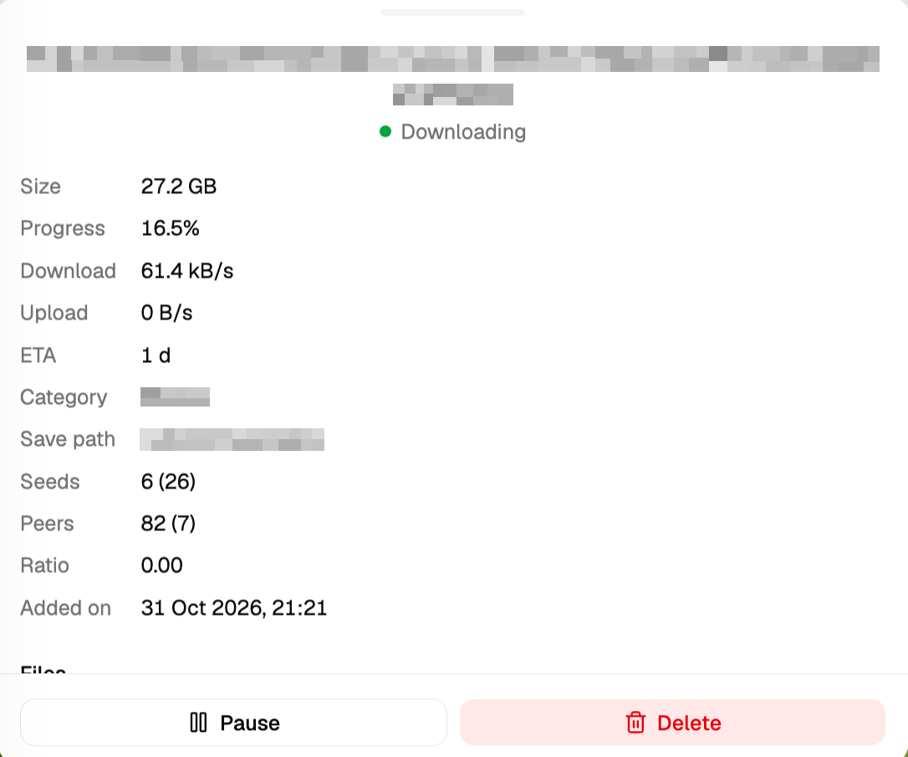
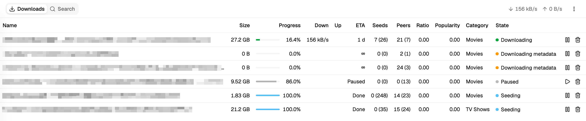
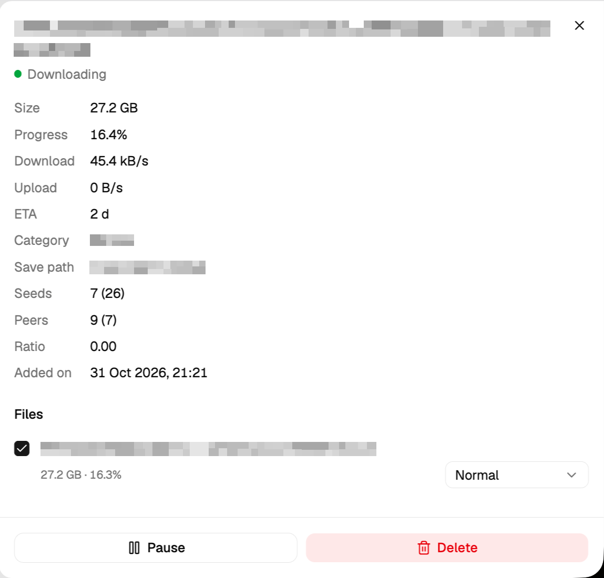
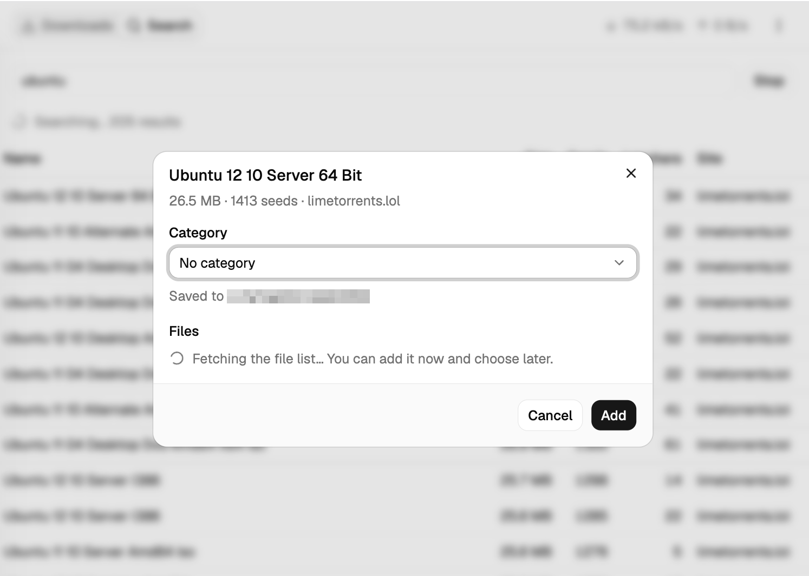

# qbit-ui

A small, mobile-first web UI for [qBittorrent](https://www.qbittorrent.org/)
5.x, made for everyday use from a phone: see how downloads are going, start,
pause or delete them, choose which of their files to download, and search
with qBittorrent's plugins to add new ones to a category. Settings and
everything else stay in the official WebUI.

It is a personal project, built with React, TypeScript, Vite, Tailwind CSS and
shadcn/ui. The UI talks to the qBittorrent WebAPI through a same-origin proxy:
Vite's in development, Caddy in the Docker image. Light and dark themes follow
the system.

## Screenshots

Torrent names and paths are blurred.

On a phone: the list, colored by state (swipe a row left to delete it), and a
torrent's details in a bottom sheet.

<p>
  
  
</p>

On a desktop: the sortable table, a torrent's details with its files, and
adding a search result with a category.



<p>
  
  
</p>

## Development

Needs Node (current LTS) and a qBittorrent with the WebUI enabled.

```bash
npm install
echo "QBT_URL=http://<qbittorrent-host>:<port>" > .env.local
npm run dev
```

Open http://localhost:5173 and log in with your qBittorrent WebUI credentials.
The dev server proxies `/api/` to `QBT_URL`, taken from the environment or from
`.env.local` (not committed; default `http://localhost:8080`).

Other scripts:

- `npm run build`: type-check and build the static site into `dist/`
- `npm run preview`: serve `dist/`, with the same proxy
- `npm run lint`: Oxlint

## Deployment (Docker)

The image builds the UI and serves it with Caddy, which also proxies `/api/` to
qBittorrent (`Dockerfile`, `Caddyfile`). `compose.yaml` runs it on the host of
qBittorrent, joined to the Docker network of the compose project that runs it.
The defaults fit qBittorrent running inside a [gluetun](https://github.com/qdm12/gluetun)
VPN container.

```bash
docker compose up -d --build
```

The UI is then at `http://<host>:8457`, plain http. Run the same command again
after updating the code.

Optional settings, in a `.env` file next to `compose.yaml`:

| Variable       | Default                   | Meaning                                    |
| -------------- | ------------------------- | ------------------------------------------ |
| `QBIT_UI_PORT` | `8457`                    | Port of the UI on the host                 |
| `QBT_URL`      | `http://gluetun:8456`     | qBittorrent as seen from the container     |
| `QBT_NETWORK`  | `qbittorrent-vpn_default` | Docker network shared with qBittorrent     |

`docker network ls` shows the network names.

If qBittorrent bypasses authentication for localhost clients, do not run this
container in qBittorrent's network namespace (such as
`network_mode: service:gluetun`): its requests would come from 127.0.0.1 and
skip the login.
